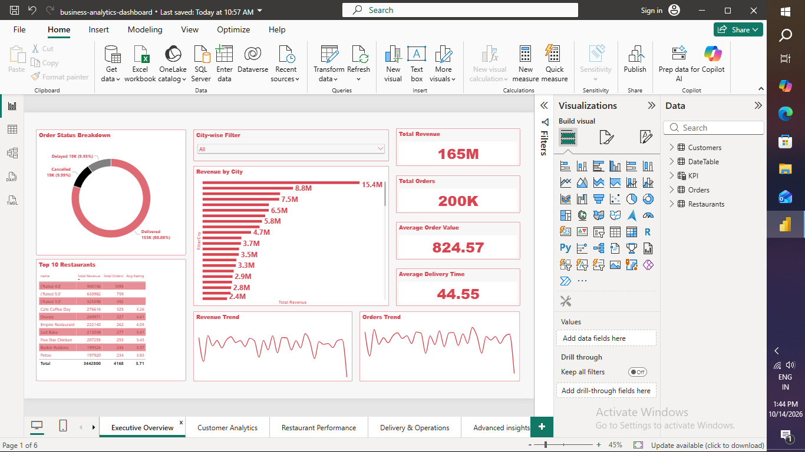
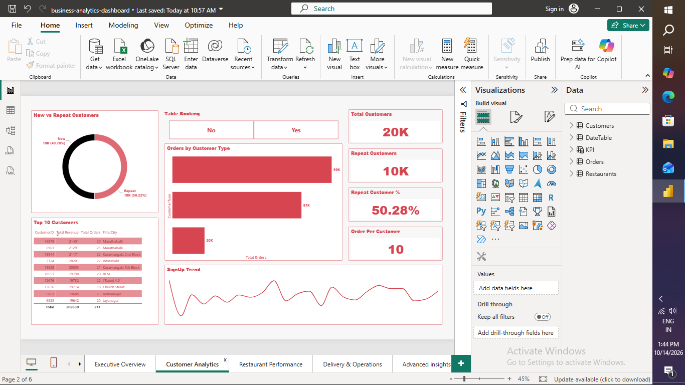
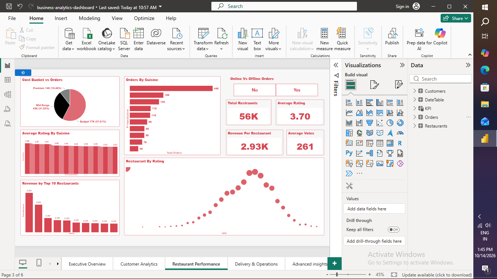
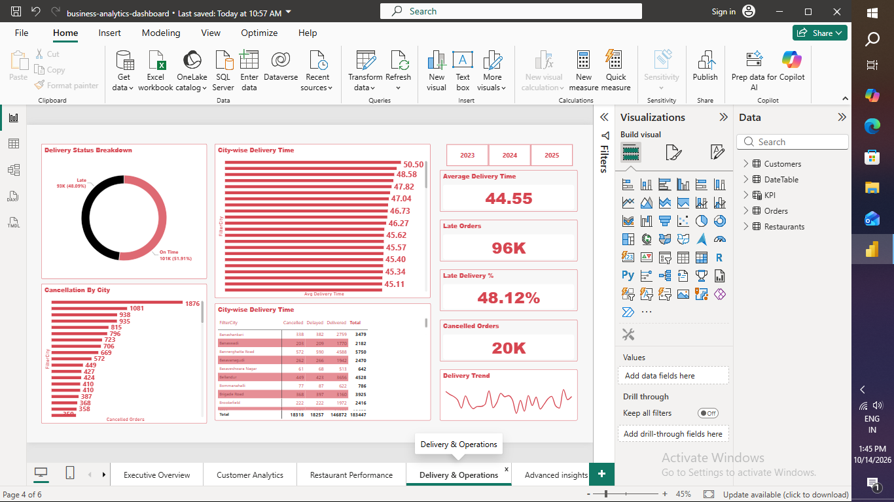
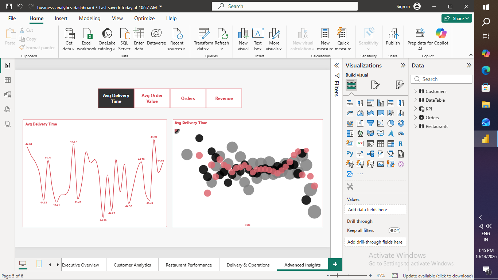
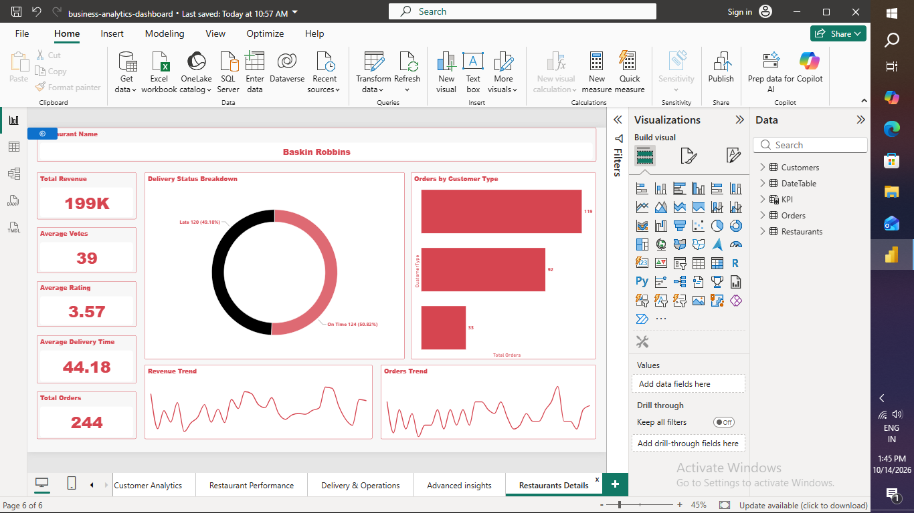

# 🍔 Food Delivery Business Analytics Dashboard (Power BI)

A multi-page Power BI dashboard built on a real-world food delivery dataset.
Tutorial followed: [YouTube](https://youtu.be/xj-ByfvYtuQ?si=iSkKUtDIzjsqrfnN)

## 📚 What I Learned

- Understanding a real-world food delivery dataset structure
- Importing and inspecting data in Power BI
- Data cleaning and transformation using Power Query
- Creating structured tables (Orders, Customers, Restaurants, Date)
- Building relationships and data modeling
- Creating calculated columns and DAX measures
- Building key business metrics (Revenue, Orders, Customers, AOV)
- Designing multiple dashboard pages with insights
- Adding slicers, filters and interactions
- Creating an industry-level Business Analytics Dashboard

## 🖼️ Dashboard Pages

**1. Executive Overview**

**2. Customer Analytics**

**3. Restaurant Performance**

**4. Delivery & Operations**

**5. Advanced Insights**

**6. Restaurant Details**

## 🛠️ Tools
Power BI Desktop · Power Query · DAX · Data Modeling
